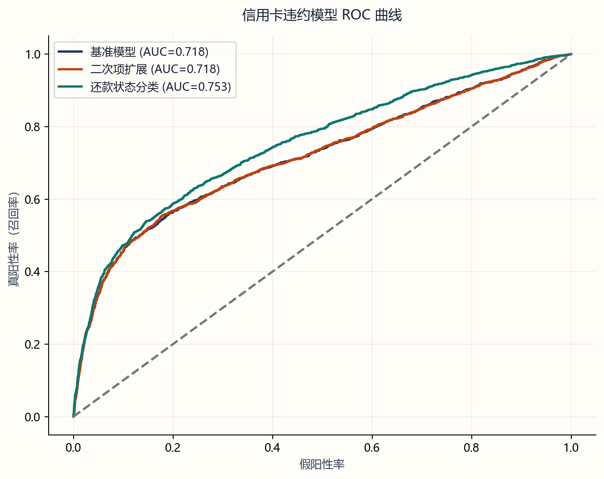
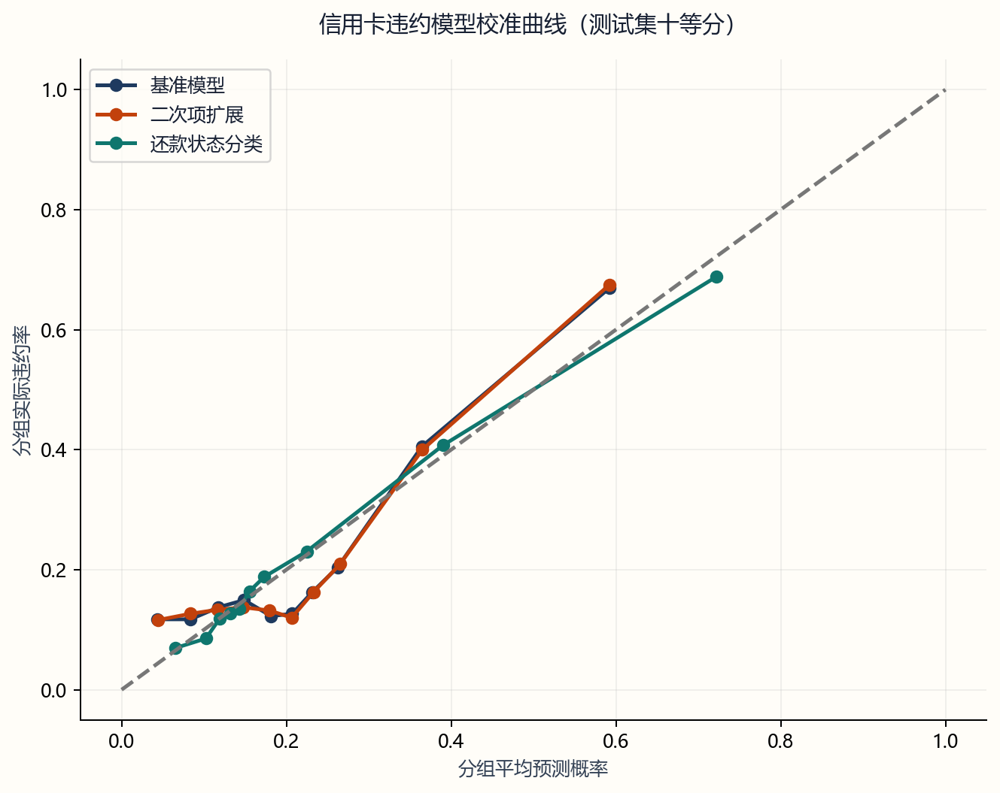
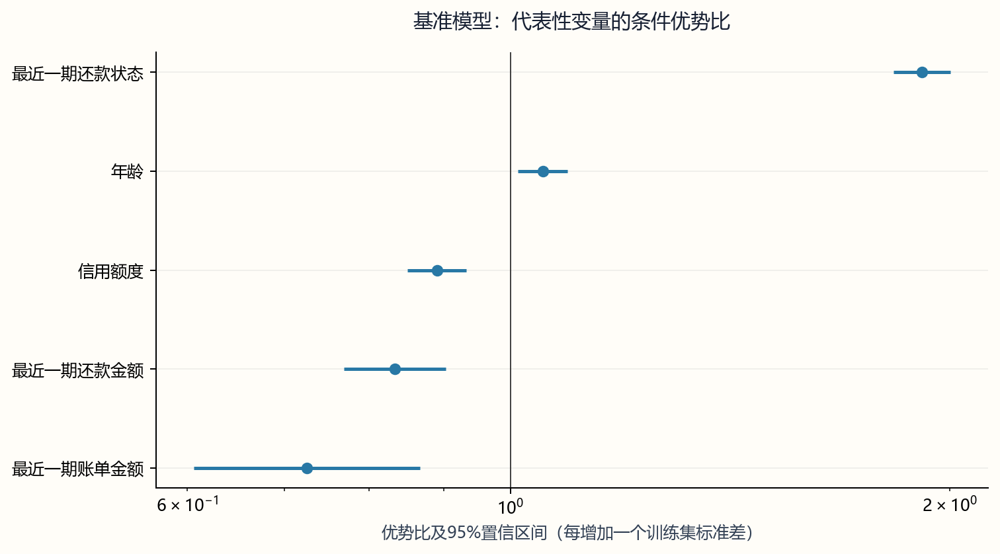

# 信用卡违约分析与 Logistic 回归比较

使用 UCI 信用卡客户数据，分析还款记录、账单和人口属性与次月违约的关系，再比较三种 Logistic 回归设定：还款状态按数值输入、年龄与额度加入平方项，以及还款状态合并为四档。三个模型使用相同的训练集和测试集。

项目使用 Python、statsmodels 和 scikit-learn，结果通过离线 HTML 报告展示。当前文件夹包含独立的运行入口、数据、依赖和论文材料。

## 实验结果

分析结果保存在 `outputs/`。数据共 30,000 名客户，其中 6,636 名次月违约，违约率为 22.12%。按标签分层划分为 22,500 条训练样本和 7,500 条测试样本，随机种子为 `42`。

### 模型比较

| 模型 | 训练集 AIC | 测试集 ROC-AUC | 测试集 AP | 测试集 Brier | 测试集准确率 |
| :--- | ---: | ---: | ---: | ---: | ---: |
| 基准模型 | 20,900.78 | 0.7175 | 0.5031 | 0.1455 | 0.8101 |
| 年龄与额度二次项模型 | 20,897.17 | 0.7177 | 0.5032 | 0.1455 | 0.8095 |
| PAY 分类模型 | 19,702.96 | **0.7533** | **0.5309** | **0.1384** | **0.8191** |

准确率使用固定阈值 `0.5`。ROC-AUC 和 AP 越高越好，Brier 越低越好。CSV 中的 `test_pr_auc` 由 `average_precision_score` 计算，表中统一记为平均精度 AP。

PAY 分类模型在这次测试中的排序表现和概率误差更好。二次项模型的 AIC 降低了 3.61，但 ROC-AUC 只增加约 0.00016，Brier 还略有上升。训练拟合改善与留出预测改善并不总是一致。

### 参数解释与非线性检验

| 项目 | 结果 | 解释 |
| :--- | ---: | :--- |
| 基准模型 PAY_0 的 OR | 1.9141 | 还款状态增加一个训练集标准差时的条件优势比 |
| PAY_0 的 OR 95% 置信区间 | 1.8297 至 2.0024 | 使用模型协方差计算的 Wald 区间 |
| PAY_0 按原始编码增加一级的 OR | 1.7835 | 仍依赖相邻编码等距的假设 |
| 两个平方项的联合似然比统计量 | 7.6112 | 自由度为 2，p 值为 0.0222 |

OR 描述违约优势的变化，不是违约概率的倍数。平方项联合检验达到 5% 显著性水平，但本次测试指标没有一致改善，因此不能仅凭 p 值选择二次项模型。

## 报告图表

完整报告见 [结果报告](outputs/结果报告.html)。用浏览器打开本地文件即可阅读，页面包含模型比较、预测曲线、参数解释和结果表下载。

### 违约客户的排序表现



三个模型在同一批测试客户上比较。PAY 分类模型的 ROC-AUC 为 0.7533，基准和二次项模型的曲线接近；报告中还提供 PR 曲线，查看不同召回水平下的查准率。

### 概率校准



每个模型按自身预测概率分成十组，比较组内平均预测概率与实际违约率。同一箱号不一定对应同一批客户，图中的偏差用于判断哪些风险段存在高估或低估。

### 代表性变量的优势比



图中列出基准模型的部分变量及其 95% 置信区间。连续项按一个训练集标准差解释，完整系数保存在 `outputs/baseline_coefficients.csv`。

## 运行项目

以下命令均在本项目根目录执行。项目已在 Python 3.10 环境运行，依赖版本见 `requirements.txt`。

### 先查看分析报告

双击 `outputs/结果报告.html`，选择浏览器打开。图表和样式已内嵌，查看报告无需安装 Python；页面中的 CSV 下载需要保留同目录的结果文件。

需要重新生成报告时，先安装依赖：

```bash
python -m pip install -r requirements.txt
```

然后运行：

```bash
python report.py
```

程序读取已有 CSV 和图片，核对结果后覆盖生成 HTML，不重新估计模型。

### 用原始数据重新运行

原始数据位于 `data/raw/credit_default.zip`。文件缺失时，从 [UCI 数据页面](https://archive.ics.uci.edu/dataset/350/default+of+credit+card+clients) 下载压缩包，并以此文件名放入 `data/raw/`。

```bash
python run.py
```

程序直接读取 ZIP 内的 Excel，依次估计三个模型，导出系数、评价指标和诊断图表。随机种子为 `42`，测试集占比为 `0.25`，参数在 `run.py` 中设置。完整运行会覆盖 `outputs/` 中的同名文件；需要保留旧结果时，先另行备份。

### 在 PyCharm 中运行

将当前文件夹作为项目打开，选择已安装依赖的 Python 解释器。右键运行 `run.py`，工作目录设为本项目根目录。只更新报告时运行 `report.py`。输入和输出路径按脚本所在目录解析。

## 部署到 GitHub Pages

本项目单独作为一个 GitHub 仓库上传。`.gitignore` 保留代码、依赖、README、HTML、CSV 和展示图片；原始数据、处理数据、论文、数据库、编辑器配置和 Python 缓存留在本机。克隆后的仓库可以直接查看报告，重新分析时按上文补齐原始 ZIP。

### 首次上传与发布

1. 在 GitHub Desktop 中添加当前项目文件夹。如果尚未创建 Git 仓库，选择 **create a repository here**，将仓库建在当前项目目录。
2. 查看 Changes，确认包含 `.gitignore`、`.github/workflows/pages.yml`、代码和 `outputs/` 中的报告、CSV、PNG，提交后点击 **Publish repository**。需要公开访问时取消 **Keep this code private**。
3. 打开 GitHub 仓库的 **Settings → Pages**，将 **Source** 设为 **GitHub Actions**。
4. 在 **Actions** 页面选择“发布分析报告”，点击 **Run workflow**。发布成功后，在 **Settings → Pages** 查看访问网址。

工作流把 `outputs/结果报告.html` 复制为站点的 `index.html`，同时发布同目录的 CSV。图表已内嵌，无需手动改名或另建发布仓库。

### 后续更新

在本机重新生成报告后，用 GitHub Desktop 提交变更，再点击 **Push origin**。推送到 `main` 或 `master` 会自动更新网页，也可在 Actions 页面手动重新发布。云端只发布已有文件，不安装 Python 或执行训练。

`.gitignore` 仅影响未跟踪文件，GitHub 网页拖拽上传也不会读取忽略规则。如果之前已经提交过数据或论文，需要另行取消这些文件的版本跟踪。首次上传建议使用 GitHub Desktop 或 Git。

## 分析方法

原始记录删除客户编号 `ID`，将教育和婚姻的异常编码归入其他类，再生成分类哑变量。连续项使用训练集均值和样本标准差进行标准化，测试集沿用同一组参数。基准模型将 PAY 还款状态按数值处理，扩展模型增加标准化年龄和额度的平方项。

PAY 分类模型将每期还款状态的原值 `≤0`、`1`、`2`、`≥3` 合为四档，以 `≤0` 为参照。这样放松了等距假设，也合并了原来含义不同的 `-2`、`-1` 和 `0`。三个设定均采用二项 GLM 和 logit 链接。

训练结果报告 AIC、系数、常规标准误及 Wald 区间；测试结果报告 ROC-AUC、AP、Brier 和准确率。二次项模型与基准模型通过似然比检验比较，PAY 分类模型不使用这一嵌套模型检验。诊断输出包括分箱校准、VIF 和 Cook 距离较高的观测。

### 指标定义

| 指标 | 计算与范围 |
| :--- | :--- |
| 违约率 | 次月违约客户数 ÷ 样本客户数 |
| ROC-AUC | 随机抽取一名违约客户和一名未违约客户，前者风险分数更高的概率；同分按一半计入 |
| AP | 按召回率增量加权的查准率平均值 |
| Brier | 预测概率与 0/1 标签之差的平方均值 |
| 准确率 | 固定阈值 `0.5` 下，预测正确的客户数 ÷ 测试客户数 |
| AIC | `2k - 2logL`，在相同训练数据上比较带参数惩罚的拟合 |
| OR | 回归系数的指数；连续项对应一个训练集标准差的变化 |

## 文件说明

| 文件 | 用途 |
| :--- | :--- |
| `run.py` | 读取原始数据、拟合三个模型并导出诊断和报告 |
| `report.py` | 核对已有结果，生成离线 HTML 报告 |
| `requirements.txt` | Python 依赖及固定版本 |
| `.gitignore` | 上传时排除本机数据、论文、环境和缓存 |
| `.github/workflows/pages.yml` | 将 HTML 和 CSV 自动发布到 GitHub Pages |
| `data/raw/credit_default.zip` | 原始客户数据 |
| `论文材料/` | 修订版 Word、课程模板及历史文稿 |

分析结果保存在 `outputs/`：

| 输出文件 | 内容 |
| :--- | :--- |
| `结果报告.html` | 可离线阅读的完整报告 |
| `summary.csv` | 样本规模、划分、随机种子和似然比检验 |
| `model_comparison.csv` | 三个模型的训练和测试指标 |
| `baseline_coefficients.csv`、`nonlinear_coefficients.csv`、`pay_categorical_coefficients.csv` | 各模型系数、标准误、p 值、OR 和区间 |
| `all_coefficients.csv` | 三个模型的合并系数表 |
| `baseline_metrics.csv`、`nonlinear_metrics.csv`、`pay_categorical_metrics.csv` | 各模型的独立评价表 |
| `calibration.csv`、`vif.csv`、`influence_top100.csv` | 校准分箱、共线性和高影响观测 |
| `roc_curves.png`、`pr_curves.png`、`calibration.png`、`coefficients.png` | 预测评价与参数解释图 |

## 结果检查

```bash
python run.py --check
```

该命令检查已有输出的字段、指标范围和人数等关系，并重建 HTML。它不会重新读取原始数据、估计模型或重算诊断，因此不能代替完整运行。

## 数据限制

数据来自 2005 年前后的台湾地区客户。当前测试集随机取自同一历史样本，尚未做时间外验证或重复划分；模型指标差异也没有置信区间。结果反映这批客户中的条件关联和预测表现。

PAY 分类模型的个别稀疏类别标准误很大，相应 OR 不适合解释为稳定的业务效应。现有区间采用常规标准误；VIF 的辅助回归不含截距，不能直接套用常规中心化 VIF 的阈值。校准分析仅有分箱比较，尚未检验校准截距和斜率，也未做高影响观测剔除后的重估。

字段月份早于次月违约标签，但公开数据没有逐客户的业务入库时间，无法据此核实实际评分日可读取的全部信息。

## 数据与参考

- [UCI Default of Credit Card Clients](https://archive.ics.uci.edu/dataset/350/default+of+credit+card+clients)：原始数据和字段说明。
- [Yeh 与 Lien（2009）](https://doi.org/10.1016/j.eswa.2007.12.020)：同一公开数据上的违约预测研究。
- [statsmodels GLM](https://www.statsmodels.org/stable/glm.html)：二项广义线性模型的估计接口。
- [scikit-learn 模型评价](https://scikit-learn.org/stable/modules/model_evaluation.html)：ROC-AUC、AP 和 Brier 等指标说明。
